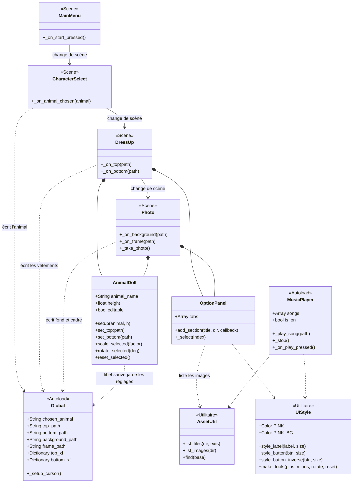
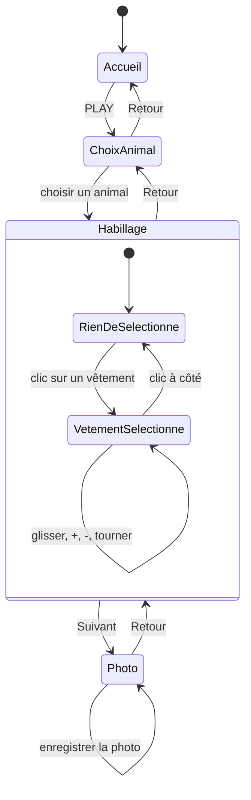
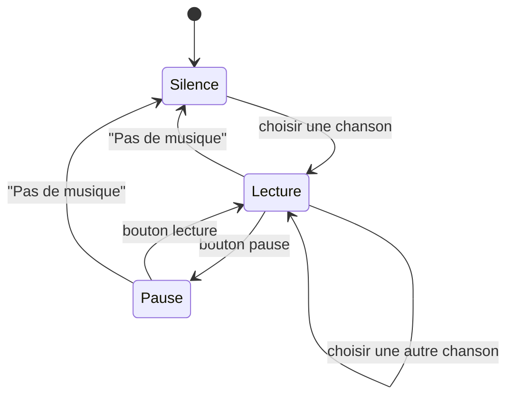
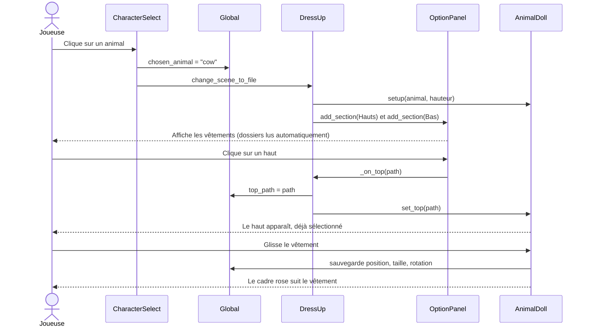
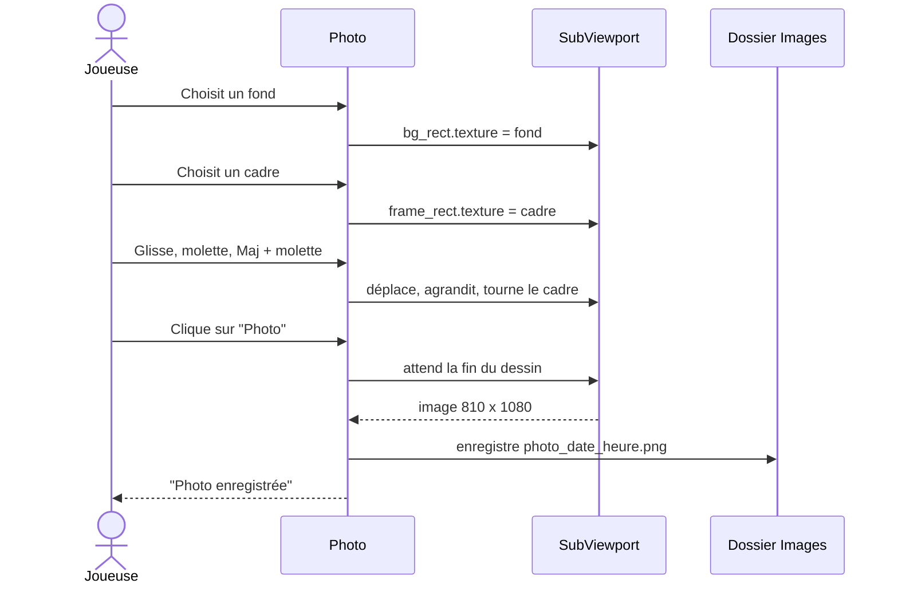
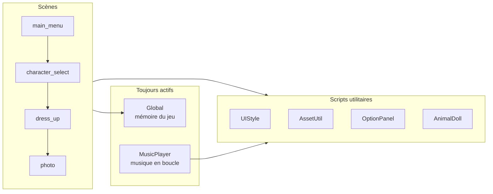

<div align="center">

# 🐄🌸 Cutie Farm 🌸🐰

### Un jeu d'habillage mignon avec mes 4 animaux dessinés à la main


*Choisis ton animal, habille-le, mets-le dans un décor, ajoute un cadre, et prends ta photo.* 📸

</div>

---

##  Hey, les gens !

C'est mon **tout premier projet avec Godot**, et mon premier projet fait avec l'aide d'une **IA** pour la partie code (les scripts GDScript).

C'est un **jeu 2D** avec **4 animaux que j'ai dessinés moi-même** : une vache, un chat, un singe et un lapin. Tout ce qui est visuel et toute l'idée du jeu viennent de moi :

- j'ai **dessiné les 4 personnages**
-  j'ai **designé les vêtements** (hauts, jupes, shorts, pantalons...)
-  j'ai **choisi et designé l'écriture** (les polices, le texte blanc avec un petit contour)
-  j'ai **pensé tout le jeu** : l'ambiance, les écrans, le rose Barbie, le curseur barbe à papa, la musique
-  l'IA m'a aidée à **corriger les scripts** pendant que je testais et que je demandais des changements

> Ce projet m'a pris beaucoup de temps, contrairement à ce que je pensais , pour une première je trouve que je me débrouille pas mal

---

##  Comment ça se joue

| Étape | Écran | Ce qu'on fait |
|:---:|---|---|
| 1 |  **Accueil** | Une ferme, un bouton **PLAY** |
| 2 |  **Choix de l'animal** | Vache, chat, singe ou lapin |
| 3 |  **Habillage** | Hauts et bas, placés à la main sur le personnage |
| 4 |  **Photo** | Fond, cadre, et enregistrement d'une vraie photo PNG |

### ✨ Ce qu'on peut faire

- **Habiller** l'animal avec des hauts et des bas (les dossiers sont lus automatiquement)
- **Déplacer** un vêtement avec la souris, le **agrandir / rétrécir** avec **+** et **-** ou la molette, le **tourner** avec **Maj + molette**
- **Choisir un fond** parmi 14 décors roses
- **Ajouter un cadre** et le déplacer, le redimensionner, le tourner
- **Écouter de la musique** en boucle pendant tout le jeu, et la changer quand on veut
- **Enregistrer sa photo** en PNG dans le dossier `Images/CutieFarm`
- Un **curseur personnalisé** en barbe à papa 🍭

###  Commandes

| Action | Commande |
|---|---|
| Sélectionner un vêtement | Clic dessus |
| Déplacer | Clic maintenu + glisser |
| Taille | Molette, ou boutons **+** / **-** |
| Rotation | **Maj + molette**, ou bouton **Tourner** |
| Revenir au placement de départ | Bouton **Reset** |

---

## Diagrammes

> Les diagrammes ci-dessous sont écrits en **Mermaid** : GitHub les affiche automatiquement.

### Diagramme de classes



###  Diagramme d'états : le parcours du jeu



###  Diagramme d'états : la musique



> La musique est un *Autoload* : elle continue pendant tous les écrans et se lit en boucle.

### Diagramme d'interaction (séquence) : habiller l'animal



### Diagramme d'interaction (séquence) : prendre une photo



### Vue d'ensemble de l'architecture



---

## Structure du projet

```
cutie-farm/
├── art/
│   ├── cow.png  cat.png  monkey.png  rabbit.png   ← mes 4 animaux
│   ├── farm.JPG                                    ← l'écran d'accueil
│   ├── top/                                        ← les hauts
│   ├── pants/                                      ← les bas
│   ├── backgrounds/                                ← les fonds
│   ├── frame/                                      ← les cadres
│   ├── boutons/                                    ← play, run, pause, curseur
│   ├── fonts/                                      ← les polices
│   └── music/                                      ← les musiques
├── scene/
│   ├── main_menu.tscn
│   ├── character_select.tscn
│   ├── dress_up.tscn
│   └── photo.tscn
├── script/
│   ├── global.gd            (Autoload)
│   ├── music_player.gd      (Autoload)
│   ├── ui_style.gd
│   ├── asset_util.gd
│   ├── option_panel.gd
│   ├── animal_doll.gd
│   ├── main_menu.gd
│   ├── character_select.gd
│   ├── dress_up.gd
│   └── photo.gd
└── project.godot
```

>  Les dossiers `top`, `pants`, `backgrounds`, `frame` et `music` sont **lus automatiquement** : pour ajouter un vêtement, un fond ou une chanson, il suffit de déposer le fichier dans le bon dossier.

---

## Lancer le jeu

1. Installer [Godot 4](https://godotengine.org/download)
2. Cloner ce dépôt :
   ```bash
   git clone https://github.com/NanouDi/cutie-farm.git
   ```
3. Ouvrir Godot, cliquer sur **Importer**, choisir le fichier `project.godot`
4. Cliquer sur le bouton **▶** en haut à droite

---

##  Fait avec

- **Godot Engine 4.7** (2D, GDScript)
- **Un assistant IA** pour corriger les scripts
- **Mes dessins** pour tout le reste 🎨
- **Pinterest** pour bcp, merci pour les travaux

---

##  La suite (Insh'Allah écoute)

- [ ] Un onglet **Accessoires** (chapeaux, lunettes, bijoux)
- [ ] Ajouter du **texte** sur la photo, avec mes polices
- [ ] Plus de vêtements et plus de fonds
- [ ] Enregistrer la photo sur téléphone
- [ ] Exporter le jeu en `.exe` pour Windows

---

## ⚠️ À propos des images et des musiques

Les dessins des animaux, des vêtements sont **à moi**, et on été crée par moi (genre déssinés cause AI art isn't it ). les fonds, cadres (dont des cadres Hello Kitty) et toutes les chansons viennent d'autres personnes (pinterest) ou d'autres marques : ils sont utilisés ici pour un **projet personnel d'apprentissage** et ne sont pas libres de droits. Si le jeu est publié un jour (même si je pense pas mdr ), ils seront remplacés.

---

<div align="center">

## 🌷 Créé par

### **Nabintou Diakite**
*Nanou pour les intimes*

⏱️ **Temps passé sur le projet :** 12h-15h heures sur 3 jours

*Fait avec beaucoup de rose, de patience et de musique de Doja* 🍭

</div>
